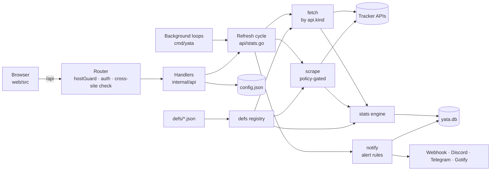

# Architecture

A map of Yata for contributors and coding agents: where things live, how a
tracker's stats travel from its API to the screen, and the rules that keep the
pieces apart. It points at the code rather than repeating it, and each package
opens with a doc comment that has the detail.

Yata is a single Go binary with a TypeScript frontend. It serves one page, a
JSON API under `/api`, and runs a few background loops. State lives in two
files: `config.json` (what you configured) and `yata.db` (SQLite: what Yata
has learned and recorded).

## Repository layout

| Path | What lives there |
|---|---|
| `cmd/yata/main.go` | Startup: flags, config, defs, database, background loops, HTTP server. |
| `internal/api` | HTTP router, middleware and every JSON handler, one file per area. Also the refresh cycle (`stats.go`). |
| `internal/defs` | Loads tracker and type definitions from `defs/` and resolves what applies to a tracker. |
| `internal/fetch` | API fetchers, chosen by a type's `api.kind`. All output uses canonical field names. |
| `internal/scrape` | Profile-page scraper and the scrape rate-limit policy. |
| `internal/stats` | The stats engine: stat layers, the merge, history, growth rates, derived account fields. |
| `internal/store` | SQLite: schema, layers, history, logs, auth, alerts. |
| `internal/config` | Owns `config.json`: in-memory copy behind a mutex, atomic saves, backups. |
| `internal/notify` | Alert rule engine and notification destinations (generic webhook, Discord, Telegram, Gotify). |
| `internal/pathways` | Invite-path engine over the community dataset in `defs/pathways/routes.json`. |
| `internal/models` | Shared structs. No tracker-specific data. |
| `internal/parse` | Size, duration and number parsing shared by fetch, stats and the API. |
| `internal/netguard`, `redact`, `fsperm`, `ident` | Outbound-request limits, credential redaction, file permissions, how Yata identifies itself to trackers. |
| `internal/logging`, `version` | Rolling logger with an in-memory tail for the Logs tab; the build version. |
| `web/src` | Frontend source (TypeScript, Vite). Built into `static/`. |
| `static/`, `templates/index.html` | Built frontend, CSS, icons, themes; the single HTML page. |
| `defs/` | Tracker definitions (`trackers/`), platform types (`types/`), pathways data, opt-outs, templates. |
| `tools/` | Dev tools: `pathsync` (pathways import), `genversions`, `defsdoc`, `screenshots.mjs`, test seeders. |

## The big picture

## One refresh, start to finish

The server-side loop in `cmd/yata/main.go` calls `api.RunRefreshCycle` every
refresh interval (default 30 minutes, floor 15), whether or not a browser is
open. The UI's refresh buttons hit the same code through `GET /api/stats`. For
each enabled tracker, `refreshTracker` (`internal/api/stats.go`):

1. **Gates.** Opted-out, retired (shut-down) and manual-entry trackers are
   never contacted; their stored stats are returned as they are. A min-age
   guard skips a fetch that happened moments ago unless the caller forces it.
2. **Fetches.** `fetch.Client.Fetch` resolves the tracker's def and type,
   picks the fetcher for `api.kind`, then applies the def's `api_drop_fields`
   and `api_field_map` and normalises values. Lists and objects are dropped,
   except `active_events`. The result is a flat map of canonical fields.
3. **Saves the API layer** (`stats.SaveAPI`), records the connection outcome
   and the per-channel check status, compares returned fields against the
   def's declared capabilities (`capdrift.go`), and refreshes a tracker-served
   group ladder if the def has one (`groupladder.go`).
4. **Falls back to a scrape** only if the API failed, and only if the scrape
   policy allows it (`tryScrapeFallback`).
5. **Merges and records.** `stats.Merged` builds the view the UI shows, then
   `RecordHistory` stores numeric fields for sparklines and long-range charts.
6. **Notices changes.** A rank change is recorded as a tracker event.
7. **Evaluates alerts** (`notify`): connection rules, stat rules, target goals
   and pinned pathways. Matches are recorded for the in-app alerts panel and
   sent to any configured destinations.

Profile scrapes also run on their own, through `POST /api/scrape/{id}`, which
the frontend's per-tracker button and auto-sync call. Every scrape, whatever
triggered it, goes through the same policy check (`internal/scrape/policy.go`)
and the persistent `scrape_log`, so nothing can hammer a tracker's site.

## Stat layers and the merge

Each tracker's stats are stored as separate **layers** in `stat_layers`:

| Layer | Written by |
|---|---|
| `api` | The fetcher, on every successful refresh. Replaced whole each time. |
| `scrape` | The profile scraper. |
| `qui` | Seed size computed from a linked qui (qBittorrent) instance. |
| `manual` | Values typed in by the user, seeded from `config.json` at startup. |

`stats.Merged` reads them in priority order, **api → scrape → manual**. The
qui setting slots `qui` in ("missing": after scrape; "prefer": before scrape;
never above the API). The first layer with a meaningful value wins each field,
and each field keeps its source, which drives the coloured dots in the UI. Two
refinements:

- **A stale API is demoted.** If the API layer is over three days old and a
  newer scrape exists, the scrape moves above it (`demoteStaleAPI`).
- **A zero doesn't close a field.** Some APIs send 0 for fields they don't
  populate, so a real number from a lower layer still fills it.

After the merge, derived fields are added (account age, login countdown,
login immunity from rank) and time-bound fields like events expire on read.

## Definitions: all tracker knowledge is data

Yata contains no tracker-specific code. Everything one tracker needs lives in
`defs/trackers/<key>.json`; everything a platform needs lives in
`defs/types/<type>.json`. A tracker can go away at any time, and removing it
should mean deleting one file.

- **Type defs** describe software (UNIT3D, a Gazelle fork, NexusPHP, …): which
  fetcher, its auth, stock field names and the baseline capabilities.
- **Tracker defs** describe one site: its URL, rank ladder (`groups`) with
  requirements and perks, account `rules` (ratio floor, seed days, login gap),
  invite requirements, scrape limits and labels, and its API differences from
  the type: `api_field_map`, `api_drop_fields`, `capabilities.api_stats_add` /
  `_omit`, or a full custom `api` block.
- **Resolution** (`internal/defs/resolve.go`): built-in defaults → type →
  tracker → user config. Rate limits combine conservatively: the longest
  interval and the smallest daily cap win, and any disable flag wins.
- `defs/optout.json` lists trackers whose operators asked not to be supported.
  `retired` marks a shut-down tracker: kept for its history, never contacted.
- Templates documenting every field: `defs/templates/tracker.template.jsonc`
  and `type.template.jsonc`.

### Fetchers by `api.kind`

| Kind | Used by | Notes |
|---|---|---|
| `unit3d` | UNIT3D trackers | `/api/user`; byte counts converted; forks covered by def field maps. |
| `custom` | Custom APIs, Gazelle forks with tokens (`gazelle_antneb`), NexusPHP, Traxary | Path, auth, field map, byte fields, success check, all from the def. |
| `gazelle_json`, `gazelle_games` | Gazelle `ajax.php` sites, GazelleGames | Dedicated fetchers for those response shapes. |
| `demo` | `test` type | Serves `test_data.json`; no network. |
| `none` | `manual`, `scrape_only`, `unknown` | No API request is made. |

A def with its own `api.path` always uses `custom`, whatever its type.

## Storage

| Where | What |
|---|---|
| `config.json` | Server settings, trackers (with API keys and cookies), targets, alert rules and destinations, display settings. Only `internal/config` reads or writes it. |
| `yata.db` → `stat_layers` | Current value of every field, per tracker and layer. |
| `history`, `history_daily` | Fine-grained points (14 days) and daily rollups (default about 2 years) for charts and growth rates. |
| `scrape_log` | Every scrape attempt (30 days); the persistent basis for scrape rate limits. |
| `tracker_events`, `connection_daily` | Rank changes and connection timeline; daily uptime rollups. |
| `tracker_checks` | Last outcome per channel (API, scrape) for the Status column and Test modal. |
| `group_ladders` | Ladders served by a tracker's own endpoint. |
| `alerts` | Recorded alerts for the in-app panel. |
| `auth`, `sessions`, `recovery_codes`, `api_tokens` | Login account, sessions, 2FA recovery codes, integration tokens. |

A housekeeping loop prunes these on their retention windows every six hours.

Settings are changed with `PATCH /api/settings`, which takes only the fields to change and applies
them under one lock (`config.PatchSettings`); a full-object `PUT` is refused. Code that changes a few
settings uses `PatchSettings` too, never "read `Settings()`, edit, `UpdateSettings`", which would put
back anything changed in between.

## Frontend

`web/src` is plain TypeScript built by Vite (`npm run build` in `web/`) into
`static/dashboard.js`, loaded by `templates/index.html`. There is no framework:
views render HTML strings and re-render on state changes.

- `main.ts`: boot (settings → trackers → stats → scrape status → render) and
  the 5-minute UI refresh. **Stale-data rule:** cached stats are merged, never
  blanked, so a failed refresh keeps showing the last good values.
- `api.ts`, `types.ts`, `state.ts`: API calls, response types, shared state.
- `views/`: grid, table, tracker detail, history charts, pathways, summary cards.
- `components/`: modals (add or edit tracker, settings), alerts, targets, qui,
  the Test modal, logs, tokens, charts.
- `utils/`: formatting and parsing (keep `units.ts` in step with
  `internal/parse`), group requirements, pacing, history aggregation.

## Feature map

| Feature | Backend | Frontend |
|---|---|---|
| Targets and goal pacing | `api/targeteval.go`, `pacing.go`, `trends.go` | `components/targetsPopover.ts`, `utils/pacing.ts` |
| Rank ladder and capabilities | `defs/capabilities.go`, `api/groupladder.go` | `views/detail.ts`, `components/capabilities.ts` |
| Alerts and weekly digest | `internal/notify`, `api/alerts.go`, `digest.go` | `components/alertsPanel.ts`, `alertsTab.ts` |
| Pathways (invite routes) | `internal/pathways`, `api/pathways.go` | `views/pathways.ts`, `utils/pins.ts` |
| qui (qBittorrent) integration | `api/qui.go`, `quiseed.go`, `quiproblems.go` | `components/qui.ts` |
| Import from Prowlarr or Jackett | `api/prowlarr.go`, `jackett.go` | Add-tracker modal |
| Tracker test and type detection | `api/trackertest.go`, `trackerdetect.go` | `components/trackerTest.ts` |
| Login, 2FA, API tokens | `api/auth.go`, `auth_2fa.go`, `totp.go`, `tokens.go` | `components/tokensTab.ts` |
| Config export, import and backups | `api/config.go`, `internal/config/backup.go` | Settings |
| Update check | `api/updates.go` (reads `versions.json`) | Settings |

## Background jobs

| Job | Cadence | Where |
|---|---|---|
| Refresh and alert evaluation | Refresh interval (default 30 min, floor 15), first run 20 s after start | `api.RunRefreshCycle` |
| Weekly digest | Checked every 5 min | `api.RunDigestIfDue` |
| Config backups (opt-in) | Checked hourly | `runScheduledBackup` |
| Housekeeping (pruning) | Every 6 h | `cmd/yata/main.go` |
| Update check (opt-in) | Daily | `api.StartUpdateChecker` |

## Security boundaries

The detail is in [SECURITY.md](SECURITY.md). In the code:

- **Inbound:** `hostGuard` (allowed hostnames), `blockCrossSite` (rejects
  cross-site state changes), `requireAuth` / `requireAuthOrToken`. Tokens reach
  only the read-only `/summary`, `/highlights` and `/history/series`.
- **Outbound:** `netguard` limits where server-side requests may go;
  `ident` sets how Yata identifies itself to trackers.
- **At rest and in logs:** `fsperm` keeps state files owner-only; `redact`
  strips credentials from errors and logs before they are written.

## Making changes

- **Support or fix a tracker:** edit its def. If the def needs something it
  can't express, add a generic def field and resolve it in `internal/defs`.
  Never branch on a tracker's name or URL in Go.
- **Add a canonical stat field:** add it where it's produced (fetcher or scrape
  labels), give it a history extractor in `internal/stats` if it's numeric,
  label and format it in the frontend, and list it in capabilities if a ladder
  requirement depends on it.
- **Add a platform:** a new type def, and a fetcher kind only if `custom`
  can't describe the API.
- **Tests:** `go vet ./... && go test ./...`, and `npx tsc --noEmit` in `web/`. Test mechanisms with a made-up def written in the
  test (see `unit3dForkRegistry` in `internal/fetch/fetch_test.go`), not with a
  real tracker's def. Type-level tests against `defs/types` are fine.
- After editing a def, reload definitions in Settings (or `POST /api/defs/reload`):
  load errors and warnings show as notices. A running Yata otherwise keeps the
  defs it loaded at startup.

More: [SETUP.md](SETUP.md) (running it), [API.md](API.md) (HTTP API),
[CONTRIBUTING.md](CONTRIBUTING.md) (workflow), [SECURITY.md](SECURITY.md).
